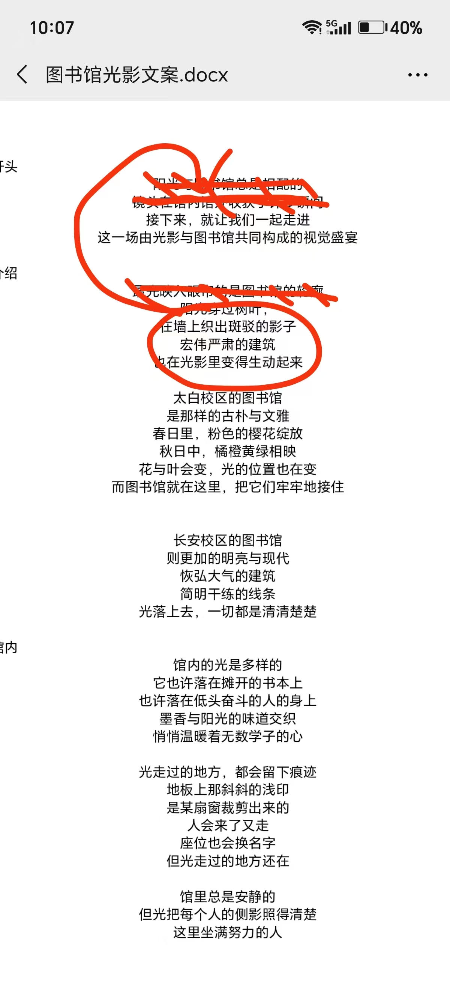
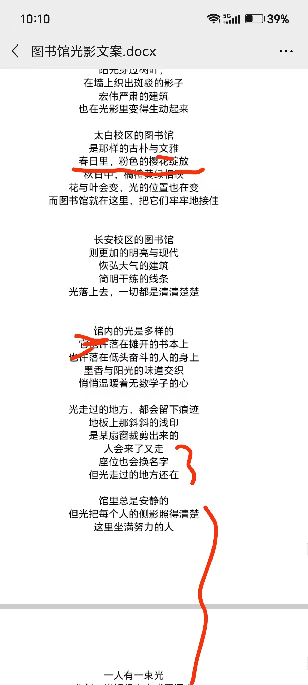
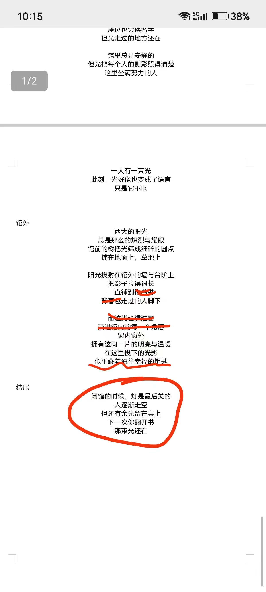

这篇是给学校官微写的光影专题，对象是图书馆。稿子写完先自己审了一遍，标出六处问题：开头铺垫太多、用词不贴切、后两段逻辑绕、角度重复、馆内外混写、结尾出戏。

下面把原稿摊开，一条一条说清楚错在哪、该怎么改。截图上的红笔是我审稿时画的。

## 原稿（未改）

展开原稿全文

开头
阳光与图书馆总是相配的
镜头在馆内馆外收获了许多瞬间
接下来，就让我们一起走进
这一场由光影与图书馆共同构成的视觉盛宴

介绍
最先映入眼帘的是图书馆的轮廓
阳光穿过树叶，在墙上织出斑驳的影子
宏伟严肃的建筑
也在光影里变得生动起来

太白校区的图书馆
是那样的古朴与文雅
春日里，粉色的樱花绽放
秋日中，橘橙黄绿相映
花与叶会变，光的位置也在变
而图书馆就在这里，把它们牢牢地接住

长安校区的图书馆
则更加的明亮与现代
恢弘大气的建筑
简明干练的线条
光落上去，一切都是清清楚楚

馆内
馆内的光是多样的
它也许落在摊开的书本上
也许落在低头奋斗的人的身上
墨香与阳光的味道交织
悄悄温暖着无数学子的心

光走过的地方，都会留下痕迹
地板上那斜斜的浅印
是某扇窗裁剪出来的
人会来了又走
座位也会换名字
但光走过的地方还在

馆里总是安静的
但光把每个人的侧影照得清楚
这里坐满努力的人
一人有一束光
此刻，光好像也变成了语言
只是它不响

馆外
西大的阳光
总是那么的炽烈与耀眼
馆前的树把光筛成细碎的圆点
铺在地面上，草地上

阳光投射在馆外的墙与台阶上
把影子拉得很长
一直铺到抱着书
背着包走过的人脚下

而这光也透过窗
洒进馆内的每一个角落
窗内窗外
拥有这同一片的明亮与温暖
在这里投下的光影
似乎藏着通往幸福的钥匙

结尾
闭馆的时候，灯是最后关的
人逐渐走空
但还有余光留在桌上
下一次你翻开书
那束光还在

## 一、开头不利落

**原句**

> 阳光与图书馆总是相配的
> 镜头在馆内馆外收获了许多瞬间
> 接下来，就让我们一起走进
> 这一场由光影与图书馆共同构成的视觉盛宴

**问题**

四行里有三行是过渡语，真正的画面一句都没有。读者决定要不要往下读，看的就是前三行，而这三行只交代了「我要写了」，没给他任何可看的东西。

**怎么改**

把最有画面感的句子提到第一句。「让我们一起走进」这类邀请句可以删，也可以压到最后一行的位置。

**改后**

> 阳光穿过树叶
> 在墙上织出斑驳的影子
> 图书馆的轮廓
> 被光一点点描出来

## 二、用词不贴切

*图 1：红圈处是开头四行和介绍的前两句，问题集中在铺垫过多。*

**原句**

> 是那样的古朴与文雅
> 秋日中，橘橙黄绿相映

**问题**

「文雅」形容的是人的举止谈吐，放在建筑上不成立，读者会觉得别扭但说不出哪里不对。「橘橙黄绿相映」是词典式的颜色堆叠，没有主体——什么在黄、什么在绿，画面立不起来。

**怎么改**

形容建筑用「静谧」「雅致」「书香氤氲」这类落到氛围上的词；写颜色要让颜色长在具体的东西上，比如银杏、法桐、台阶。

**改后**

> 太白校区的图书馆
> 古朴，也安静
> 春天，樱花落在台阶上
> 秋天，银杏把一条路铺成金色

## 三、后两段逻辑绕

**原句**

> 光走过的地方，都会留下痕迹
> 地板上那斜斜的浅印
> 是某扇窗裁剪出来的
> 人会来了又走
> 座位也会换名字
> 但光走过的地方还在

**问题**

一段里塞了三个中心：痕迹、斜印、人来人往。读到「但光走过的地方还在」，得回头找这个「地方」指哪儿，主线断了。前一段的「它也许落在……也许落在……」是并列，不是递进，读着平。

**怎么改**

一段只留一个中心句，先给判断，再给证据。并列的「也许」改成有推进关系的排列，比如按时间走一遍。

**改后**

> 馆内的光，形状各不相同
> 早晨是斜的，爬上第一排书架
> 正午是方的，落在长桌中间
> 傍晚最长，一直铺到门口
> 人来了又走，座位换了名字
> 光留下的形状，还在

## 四、角度重复

*图 2：除圈出的两处，右侧那条长波浪线贯穿馆内三段——三段都在写「光落下来、人在努力」。*

**原句**

> 馆内的光是多样的
> 它也许落在摊开的书本上
> 也许落在低头奋斗的人的身上

**问题**

馆内三段，落点都是「光落在人身上，人很努力」，同一个意思换了三种说法。读者的感受是「这段好像在哪儿读过」。

**怎么改**

给每段一个唯一的拍摄对象，互不交叉：

- 空间：书架、长桌、窗格
- 人：侧影、翻页、趴着睡着
- 书与资源：书脊、还书车、检索屏

写完自检一句：这三段能不能各自独立配一张图？不能，说明还在重复。

**改后**（第三段示例）

> 还书车停在窗边
> 书脊一排排站着
> 有人刚把一本书放回去
> 光正好落回它原来的位置

## 五、内外混写

*图 3：划掉的是馆外段末尾回头写馆内的几句，整段圈住的是结尾。*

**原句**

> 而这光也透过窗
> 洒进馆内的每一个角落
> 窗内窗外
> 拥有这同一片的明亮与温暖

**问题**

这一段的场景是馆外，读者已经站到台阶上了，句子突然又把他拉回馆内，空间层次被撤掉一次。更麻烦的是「窗内窗外」这种合并句放在中段，等于提前把结尾的总结用掉了。

**怎么改**

馆外就纯写馆外：建筑外观、四季景致、人来人往。「窗内窗外」这种合并视角留到最后一段做总结，不当中段过渡。

**改后**

> 台阶上坐着一排人
> 有人把书摊在膝盖上
> 影子从他们脚边
> 慢慢移过去

## 六、结尾出戏

**原句**

> 闭馆的时候，灯是最后关的
> 人逐渐走空
> 但还有余光留在桌上
> 下一次你翻开书
> 那束光还在

**问题**

画面其实是全篇最好的：闭馆、关灯、余光还留在桌上。问题在调性——前面一直是集体视角的叙述，这里突然转成对「你」说话的私语，「那束光还在」又把「光」重复用了一次，收得轻，像是另一篇文章的结尾。

**怎么改**

保留闭馆—关灯—余光这个画面，最后两行从个人抬到群体，用一组对仗收住。「你」可以不出来，官微的「你」通常放在最后一句互动里。

**改后**

> 闭馆时，灯是最后关的
> 人走了，余光还留在桌上
> 光不说话，只是等
> 等下一个坐下来的人

或者更硬一点的对仗收尾：

> 一室书香，藏着四季
> 半窗光影，照见少年

## 发布前自查六问

1. 前三行有没有一个具体的画面？
2. 每个形容词是不是用对了对象？
3. 每段能不能用一句话说清中心？
4. 相邻两段是不是在写同一件事？
5. 写馆外的段落有没有回头写馆内？
6. 结尾有没有从景物落到人，并且没有重复使用同一个意象？

---

原稿不是写得差，问题都在「先后顺序」和「每段只干一件事」。按这六条重排，句子几乎不用换，观感就变了。这也是官微图文最容易见效的改法：先调结构，再磨句子。
